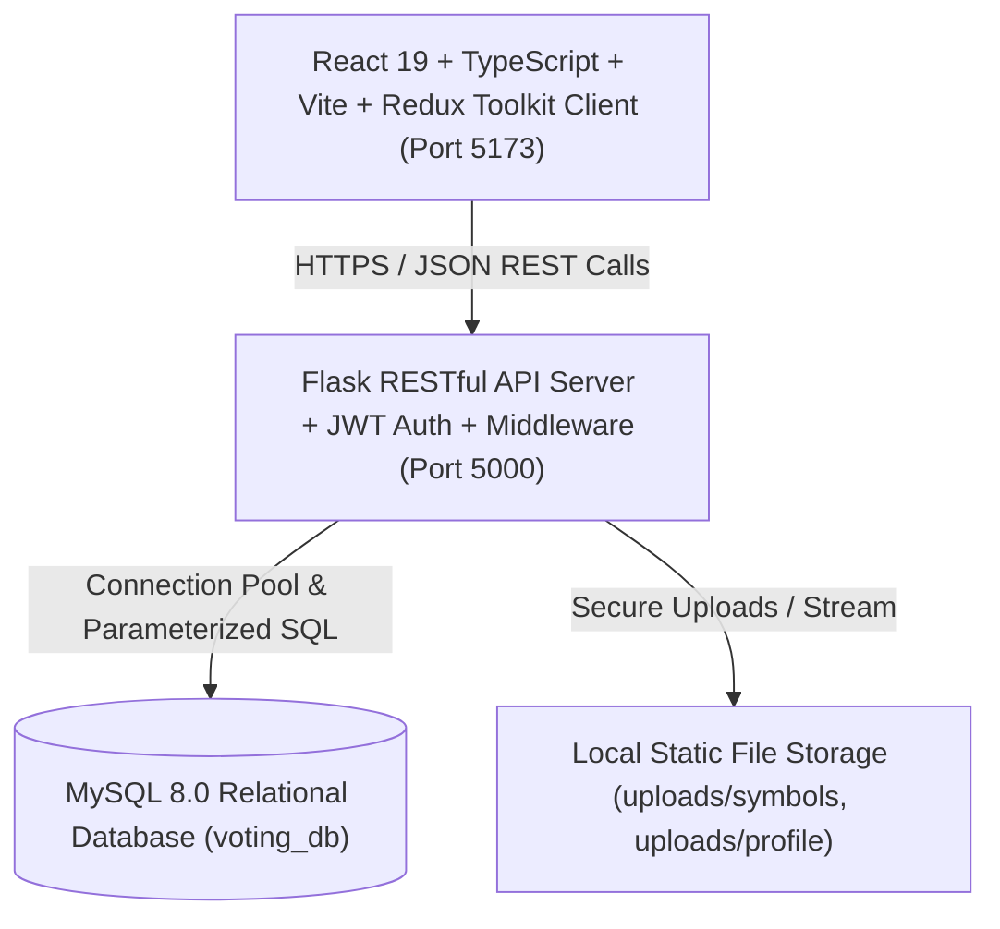
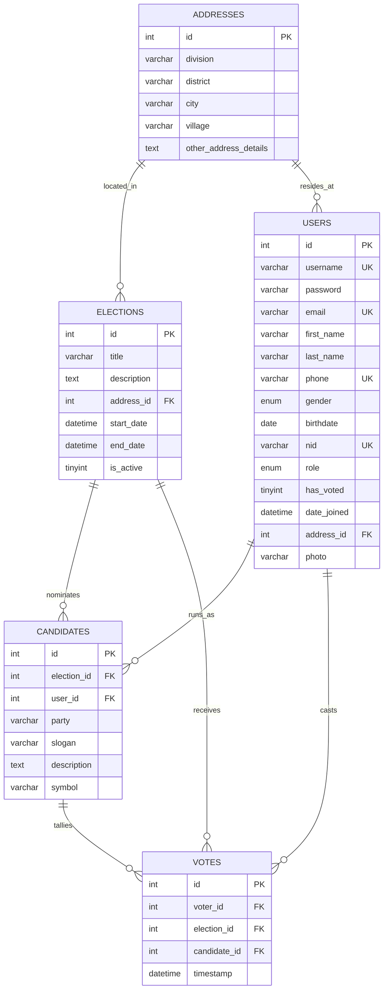

# Electronic Voting Machine (EVM) — Secure Digital Electoral Platform

[](#)
[](#)
[](#)
[](#)
[](#)
[](#)

A production-ready, full-stack **Electronic Voting Machine (EVM)** and election administration system. The platform guarantees transparent, verifiable, and fraud-resistant digital voting through end-to-end cryptographic safeguards, database-enforced one-vote-per-citizen integrity, role-based governance, and real-time certified result tabulation.

---

## Table of Contents

1. [Architecture & Technology Stack](#1-architecture--technology-stack)
2. [Role-Based Access Hierarchy](#2-role-based-access-hierarchy)
3. [Key Features](#3-key-features)
4. [Security & Cryptographic Integrity](#4-security--cryptographic-integrity)
5. [Database Schema & Integrity Constraints](#5-database-schema--integrity-constraints)
6. [API Reference Documentation](#6-api-reference-documentation)
7. [Default Seed Credentials for Testing](#7-default-seed-credentials-for-testing)
8. [Local Development Setup](#8-local-development-setup)
9. [Running Automated Test Suites](#9-running-automated-test-suites)
10. [Production Deployment Guide](#10-production-deployment-guide)

---

## 1. Architecture & Technology Stack



- **Frontend**: React 19, TypeScript 5.8, Vite 7.1, Redux Toolkit 2.8, React Router v7, Bootstrap 5.3, React Icons.
- **Backend**: Python 3.15 / 3.11+, Flask 3.1, Flask-CORS, mysql-connector-python, PyJWT, Werkzeug.
- **Database**: MySQL 8.0 / MariaDB with UTF-8 Multilingual Collation (`utf8mb4_unicode_ci`).
- **Authentication**: Stateless JSON Web Tokens (JWT HS-256) with 24-hour expiration and PBKDF2:SHA256 password hashing.

---

## 2. Role-Based Access Hierarchy

The system defines four strictly enforced user roles:

| Role | Permissions & Operational Scope |
| :--- | :--- |
| **`super_admin`** | Top-level authority. Can promote/demote user roles (including creating other Super Admins), manage all elections, candidates, system settings, audit logs, and oversee the entire national database. |
| **`admin`** | Administrative authority. Can create, edit, delete, and schedule elections; nominate and manage candidates; review voter registrations; provision Presiding Officer accounts; and monitor live metrics. |
| **`presiding_officer`** | Polling station controller. Can open/pause voting on active elections; nominate candidates; monitor voter turnout and station ballots; and view real-time tallies. |
| **`voter`** | Registered citizen. Can view active and upcoming elections, review candidate profiles and symbols, cast one official ballot per election, verify their vote status, and update their profile. |

---

## 3. Key Features

- **Constituency & Electoral Mapping**: Elections are linked to geographic constituencies (`addresses` table: division, district, city, village) for localized or national voting.
- **Strict One-Vote-Per-Citizen**: The database enforces a `UNIQUE KEY (voter_id, election_id)` constraint, making double-voting physically impossible at the storage layer.
- **Real-Time Live Results**: Public and administrative dashboards feature auto-updating vote tallies, percentage distribution progress bars, and certified winner/leader calculation.
- **Digital Candidate Ballots**: Candidates display verified party symbols, personal photo avatars, slogans, and campaign manifestos.
- **Election Countdown & Scheduling**: Automated time-window verification ensures voting is only permitted between certified `start_date` and `end_date`.
- **1-Click Demo Login**: Login interface includes quick-fill buttons for all 4 roles to facilitate immediate demonstration and QA testing.
- **Responsive Interface**: Fully optimized for desktop, tablet, and mobile browsers with Bootstrap 5.3 and custom modern styling.

---

## 4. Security & Cryptographic Integrity

1. **Password Hashing**: Passwords are cryptographically salted and hashed using PBKDF2:SHA256 with 1,000,000 iterations via Werkzeug security primitives. Plaintext passwords are never stored.
2. **Stateless JWT Authentication**: Authenticated sessions utilize signed JSON Web Tokens carrying verified `user_id` and `role` claims with expiration guards.
3. **Double-Voting Prevention**:
   - Application-layer verification queries prior to vote submission.
   - Database-layer `UNIQUE (voter_id, election_id)` constraint rejects any race-condition or duplicate payload with an HTTP 409 Conflict.
4. **Election Window Validation**: The server validates `start_date <= now() <= end_date` and `is_active == 1` before accepting any vote.
5. **SQL Injection Defense**: Every database interaction uses strict parameterized queries (`%s` placeholders).
6. **Role Guard Middleware**: Centralized `roles_required` decorator validates role access, with Super Admin inheritance.

---

## 5. Database Schema & Integrity Constraints

The database `voting_db` comprises five normalized tables:



### Key Database Constraints:
- `votes`: `UNIQUE KEY unique_voter_election (voter_id, election_id)`
- `candidates`: `UNIQUE KEY unique_candidate_election (election_id, user_id)`
- `users`: `UNIQUE KEY (username)`, `UNIQUE KEY (email)`, `UNIQUE KEY (nid)`, `UNIQUE KEY (phone)`

---

## 6. API Reference Documentation

### Authentication (`/auth`)
| Method | Endpoint | Access | Description |
| :--- | :--- | :--- | :--- |
| `POST` | `/auth/register` | Public | Register new voter account with NID and contact details. |
| `POST` | `/auth/login` | Public | Authenticate via username/email/phone & password; returns JWT token and profile. |

### Elections (`/elections`)
| Method | Endpoint | Access | Description |
| :--- | :--- | :--- | :--- |
| `GET` | `/elections` | Public | List all elections with candidate counts and ballot tallies. |
| `GET` | `/elections/active` | Public | Retrieve currently active electoral event. |
| `GET` | `/elections/<id>` | Public | Retrieve detailed election information by ID. |
| `POST` | `/elections` | Admin/Officer | Create and schedule a new election event. |
| `PUT` | `/elections/<id>` | Admin/Officer | Update election title, dates, constituency, and status. |
| `PATCH`| `/elections/<id>/status`| Admin/Officer | Toggle active/paused voting status (`is_active: 0/1`). |
| `DELETE`| `/elections/<id>`| Admin | Delete election and cascade associated ballots. |

### Candidates (`/candidates`)
| Method | Endpoint | Access | Description |
| :--- | :--- | :--- | :--- |
| `GET` | `/candidates` | Public | List candidates (filterable by `?election_id=<id>`) with vote counts. |
| `GET` | `/candidates/<id>` | Public | Retrieve single candidate details. |
| `POST` | `/candidates` | Admin/Officer | Nominate candidate with party, slogan, and symbol image upload. |
| `PUT` | `/candidates/<id>` | Admin/Officer | Update candidate information or symbol. |
| `DELETE`| `/candidates/<id>`| Admin/Officer | Remove candidate nomination and associated votes. |
| `GET` | `/uploads/symbols/<file>`| Public | Serve candidate electoral symbol graphic. |

### Balloting & Results (`/votes`, `/stats`)
| Method | Endpoint | Access | Description |
| :--- | :--- | :--- | :--- |
| `POST` | `/elections/<id>/vote` | Authenticated | Cast official ballot for candidate in election `<id>`. |
| `GET` | `/elections/<id>/vote-status` | Authenticated | Check if current logged-in user has voted in election `<id>`. |
| `GET` | `/elections/<id>/results` | Public | Fetch live candidate standing percentages and certified winner. |
| `GET` | `/stats/overview` | Public | Get aggregate metrics (total voters, elections, votes, candidates). |

### Citizens & User Governance (`/user`)
| Method | Endpoint | Access | Description |
| :--- | :--- | :--- | :--- |
| `GET` | `/user/current-user` | Authenticated | Retrieve profile for authenticated user session. |
| `GET` | `/user/all` | Admin/Officer | List all citizens and staff with constituency and vote flags. |
| `GET` | `/user/<id>` | Self/Admin | Retrieve specific user profile. |
| `PUT` | `/user/edit/<id>` | Self/Admin | Update profile details and upload avatar photo. |
| `PATCH`| `/user/<id>/role` | Admin/Super | Change user role (`voter`, `presiding_officer`, `admin`, `super_admin`). |
| `POST` | `/user/create` | Admin/Super | Directly provision officer or administrative staff accounts. |
| `DELETE`| `/user/<id>` | Admin/Super | Delete user account (safeguarded against self-deletion). |
| `GET` | `/user/uploads/profile/<file>`| Public | Serve user profile avatar photo. |

### Geographic Constituencies (`/addresses`)
| Method | Endpoint | Access | Description |
| :--- | :--- | :--- | :--- |
| `GET` | `/addresses` | Public | List all electoral divisions and districts. |
| `GET` | `/addresses/<id>` | Public | Get constituency address by ID. |
| `POST` | `/addresses` | Admin/Officer | Create new constituency location. |
| `PUT` | `/addresses/<id>` | Admin/Officer | Update constituency details. |
| `DELETE`| `/addresses/<id>` | Admin | Remove address entry. |

---

## 7. Default Seed Credentials for Testing

All seeded test accounts share the password: `Password123!`

| Role | Username | Email | Permissions |
| :--- | :--- | :--- | :--- |
| **Super Admin** | `superadmin` | `superadmin@evm.com` | Root system access, role governance |
| **Admin** | `admin` | `admin@evm.com` | Elections, candidates, user management |
| **Presiding Officer** | `officer` | `officer@evm.com` | Station control, election start/pause, candidate management |
| **Citizen Voter 1** | `voter1` | `voter1@evm.com` | Standard voter (can vote, view results, edit profile) |
| **Citizen Voter 2** | `voter2` | `voter2@evm.com` | Standard voter (eligible to vote) |

*Note: You can also use the 1-Click Demo buttons on the `/login` screen to automatically fill these credentials.*

---

## 8. Local Development Setup

### Prerequisites
- Node.js (v18+ recommended) & npm
- Python (3.11+ or 3.15+)
- MySQL Server 8.0 (e.g. via XAMPP or native service) running on port `3306`

### Database Setup
1. Start your local MySQL service.
2. Create and seed the database using the provided SQL dump:
   ```bash
   mysql -u root -p -e "CREATE DATABASE IF NOT EXISTS voting_db CHARACTER SET utf8mb4 COLLATE utf8mb4_unicode_ci;"
   mysql -u root -p voting_db < db/voting_db.sql
   ```

### Backend Setup (`server/`)
1. Open a terminal in the `server` folder:
   ```bash
   cd server
   ```
2. Copy environment variables:
   ```bash
   cp .env.example .env
   ```
   *(Update MySQL credentials in `.env` if your MySQL user/password differs from `root` / empty).*
3. Install Python dependencies:
   ```bash
   pip install -r requirements.txt
   ```
4. Run the backend server:
   ```bash
   python app.py
   ```
   *The API will start at `http://localhost:5000`.*

### Frontend Setup (`client/`)
1. Open another terminal in the `client` folder:
   ```bash
   cd client
   ```
2. Install npm packages:
   ```bash
   npm install
   ```
3. Copy frontend environment file:
   ```bash
   cp .env.example .env
   ```
4. Run the Vite development server:
   ```bash
   npm run dev
   ```
   *The web client will be available at `http://localhost:5173`.*

---

## 9. Running Automated Test Suites

The project includes unit, integration, and full lifecycle end-to-end test suites.

### Backend Automated Tests
From the `server/` directory:
```bash
# Run unit & API integration test suite
python -m unittest test_backend.py

# Run complete End-to-End voting & governance lifecycle test
python -m unittest test_e2e_workflow.py

# Run all tests simultaneously
python -m unittest discover -p "test_*.py"
```

### Frontend Build & Lint Verification
From the `client/` directory:
```bash
# Type-check and production bundle build
npm run build

# Run code linter
npm run lint
```

---

## 10. Production Deployment Guide

### 1. Backend Production Service (Gunicorn + Nginx)
Run the Flask backend using an enterprise WSGI server such as Gunicorn:
```bash
cd server
pip install gunicorn
gunicorn --workers 4 --bind 127.0.0.1:5000 app:app
```

Example Nginx reverse proxy configuration block:
```nginx
server {
    listen 80;
    server_name evm.yourdomain.com;

    # Serve built React frontend
    location / {
        root /var/www/evm/client/dist;
        try_files $uri $uri/ /index.html;
    }

    # Reverse proxy API requests
    location /auth/ { proxy_pass http://127.0.0.1:5000/auth/; }
    location /user/ { proxy_pass http://127.0.0.1:5000/user/; }
    location /elections { proxy_pass http://127.0.0.1:5000/elections; }
    location /candidates { proxy_pass http://127.0.0.1:5000/candidates; }
    location /stats/ { proxy_pass http://127.0.0.1:5000/stats/; }
    location /addresses { proxy_pass http://127.0.0.1:5000/addresses; }
    location /uploads/ { proxy_pass http://127.0.0.1:5000/uploads/; }
}
```

### 2. Frontend Production Build
Build the optimized, minified production assets:
```bash
cd client
npm run build
```
The compiled output is located in `client/dist/` ready to be served by Nginx, Cloudflare, or Vercel.

---

## License & Integrity Declaration
This software is architected and built to adhere to democratic principles of transparent electoral governance, citizen anonymity, verifiable vote counting, and robust cryptographic data protection.
